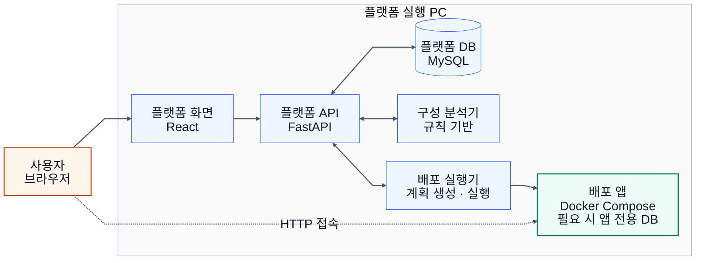
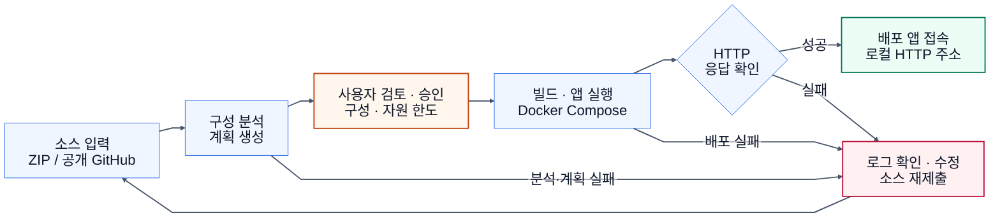

<!--
발표용: 16:9 슬라이드마다 차트 하나를 배치하고, SVG로 옮겨 비율을 유지한다.
흰 배경 · 기본 24px · 연결선 글자 22px · 맑은 고딕/Noto Sans KR.
구성요소는 파랑, 사용자 승인은 주황, 접속 성공은 초록, 실패 대응은 분홍.
색상 없이도 노드 문구와 화살표로 의미를 구분한다.
근거: docs/ONPREM.md, scripts/onprem_service.py, scripts/onprem.compose.yaml,
infra/worker/local_docker.py, infra/worker/worker.py, front/src/onprem/.
기준: 2026-10-10-managed-domains-v1 / origin/main 8145c21a70466b07717c1780e7f5385b6af5208f.
현재 요청에 따라 구현된 온프레미스 경로만 표현한다. 전체 제품 방향 변경은 아니다.
-->

## 온프레미스 배포 — 구성

## 온프레미스 배포 — 흐름

